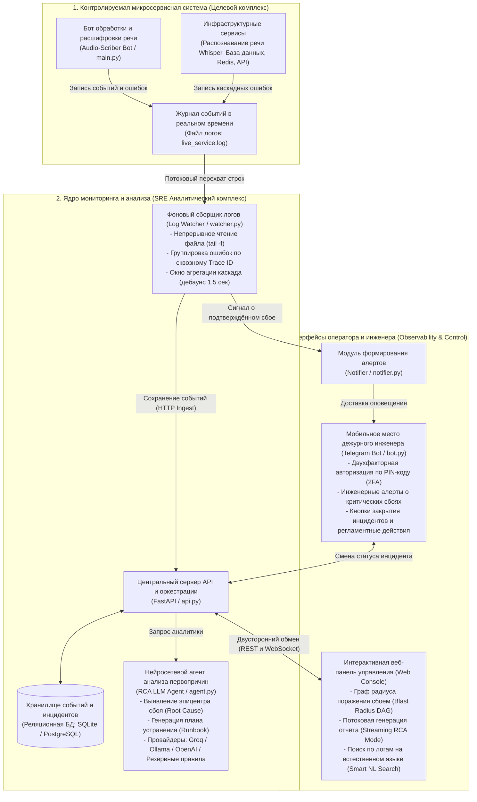

# SRE Log RCA Agent & Observability Platform

[](https://www.python.org/)
[](https://fastapi.tiangolo.com/)
[](https://www.sqlalchemy.org/)
[](https://aiogram.dev/)
[](LICENSE)

Комплексная автономная **SRE-платформа мониторинга**, сбора распределённых логов, автоматического анализа первопричин аварий (**Root Cause Analysis, RCA**) с использованием языковых моделей (**LLM**) и доставки сжатых инженерных оповещений в **Telegram**.

Система фиксирует каскадные сбои микросервисов, выявляет эпицентры сбоев по сквозным `trace_id`, визуализирует радиус поражения (**Blast Radius DAG**) в веб-интерфейсе и предлагает регламентные действия по восстановлению (**Runbook Actions**).

---

## Архитектура системы (System Architecture)

Схема взаимодействия компонентов: от возникновения сбоя в микросервисах до анализа первопричин искусственным интеллектом и оповещения дежурного инженера.



### Как это работает простыми словами:
1. **Фиксация сбоя**: При возникновении ошибки микросервисы записывают событие со сквозным идентификатором запроса (`trace_id`) в общий журнал логов `live_service.log`.
2. **Перехват и группировка**: Фоновый сервис `watcher.py` моментально считывает новые записи, связывает цепочку каскадного падения за 1.5 секунды и сохраняет данные в БД.
3. **Нейросетевой анализ (RCA)**: Языковая модель (LLM) анализирует всю цепочку ошибки, определяет, какой сервис упал первым (эпицентр) и что именно произошло.
4. **Уведомление и устранение**: Инженер получает краткий алерт в Telegram с готовой командой восстановления (Bash/SQL), а на веб-дашборде видит наглядный граф того, как ошибка распространялась по сервисам.

---

## Ключевые возможности

- 🚀 **Потоковая генерация отчётов (Streaming Mode)**:
  - Генерация RCA-отчёта токен-за-токеном в реальном времени (`POST /rca/analyze/stream`).
  - Поддержка локальной **Ollama**, облачных **Groq** и **OpenAI**, а также встроенного детерминированного **Fallback-движка**.
  - Плавный рендеринг в UI с пульсирующим курсором и WebSocket-синхронизацией вкладок.

- 📊 **Интерактивный граф сбоев (Blast Radius DAG)**:
  - Визуализация каскадного падения сервисов от эпицентра (Root Cause) до сопутствующих звеньев.
  - Инспектор узлов с детальным просмотром стек-трейсов и регламентными командами (Bash / SQL / Docker).

- 🔍 **Поиск по логам на естественном языке (Smart NL Query Formalizer)**:
  - Встроенный модуль `LogQueryFormalizer` автоматически переводит фразы инженера (например, *«почему упал whisper вчера из-за памяти»*) в структурированные SQL-фильтры по сервисам, временным диапазонам и сигнатурам ошибок.

- 📱 **Мобильное рабочее место SRE (Telegram Bot)**:
  - Безопасная 2FA-привязка дежурного инженера по 4-значному PIN-коду через веб-панель.
  - Инженерные алерты без мусора с кнопками смены статуса (`Resolved / Reopen`) и сброса кэша.

---

## Структура проекта

```text
log-rca-agent/
├── api.py                    # Центральный FastAPI сервер и REST API
├── bot.py                    # Telegram-бот дежурного инженера (aiogram 3.x)
├── main.py                   # Целевой сервис мониторинга (Audio-Scriber)
├── run_analysis.py           # CLI-утилита быстрого запуска RCA-анализа
├── simulate_traffic.py       # Симулятор боевого трафика и фоновых ошибок
├── seed_logs.py              # Быстрое наполнение тестовой базы инцидентами
├── generate_dataset.py       # Экспорт и генерация каскадных сценариев
├── start_services.bat        # Скрипт единого запуска всех сервисов на Windows
├── requirements.txt          # Зависимости Python
├── .env.example              # Пример файла конфигурации
│
├── src/                      # Модули ядра платформы
│   ├── agent.py              # LLM RCA агент и потоковый генератор
│   ├── analyzer.py           # Детектор каскадных инцидентов и группировка
│   ├── config.py             # Настройки Pydantic Settings и окружения
│   ├── db.py                 # Подключение SQLAlchemy и сессии
│   ├── formalizer.py         # Разбор естественного языка в запросы к логам
│   ├── incident_store.py     # Хранилище статусов и истории инцидентов
│   ├── loader.py             # Батч-загрузчик лог-файлов
│   ├── log_search.py         # Движок полнотекстового поиска и пагинации
│   ├── models.py             # Модели SQLAlchemy (LogEvent, LogTemplate)
│   ├── notifier.py           # Доставка и форматирование Telegram-алертов
│   ├── parser.py             # Синтаксический разбор строк и JSON логов
│   ├── retention.py          # Политика ротации и очистки устаревших данных
│   └── watcher.py            # Realtime tail-f фоновый воркер с дебаунсом
│
├── templates/
│   └── index.html            # Web-дашборд (Tailwind, Lucide, Cytoscape/DAG)
│
├── tests/                    # Комплект автоматических тестов
│   ├── conftest.py
│   ├── test_api_endpoints.py
│   ├── test_log_search.py
│   ├── test_parser.py
│   ├── test_security.py
│   └── test_stream_endpoint.py
│
└── datasets/                 # Эталонные датасеты логов
    └── production_sample.log
```

---

## Быстрый старт

### 1. Клонирование и подготовка окружения

```bash
git clone https://github.com/your-username/log-rca-agent.git
cd log-rca-agent

python -m venv .venv

# Для Windows:
.venv\Scripts\activate

# Для Linux/macOS:
source .venv/bin/activate

pip install -r requirements.txt
```

### 2. Настройка конфигурации

Создайте файл `.env` на основе примера:
```bash
cp .env.example .env
```

Отредактируйте параметры (при необходимости укажите ключи LLM и Telegram бота):
```env
TELEGRAM_BOT_TOKEN=1234567890:ABCdefGHIjklMNOpqrsTUVwxyz
LLM_PROVIDER=groq
GROQ_API_KEY=your_groq_api_key_here
DATABASE_URL=sqlite:///./logs.db
```

### 3. Запуск платформы

#### Вариант А: Windows (один клик)
Запустите скрипт:
```cmd
start_services.bat
```

#### Вариант Б: Ручной запуск компонентов
В отдельных терминалах выполните:

1. **API и Web-интерфейс**:
   ```bash
   uvicorn api:app --reload --port 8000
   ```
2. **Фоновый сборщик логов**:
   ```bash
   python -m src.watcher
   ```
3. **SRE Telegram Bot**:
   ```bash
   python bot.py
   ```

После запуска панель мониторинга доступна по адресу:  
👉 **http://127.0.0.1:8000**

---

## Тестирование и симуляция аварий

1. **Генерация тестового инцидента в целевом сервисе**:
   Отправьте команду `/test_crash` в Audio-Scriber боте или запустите симулятор:
   ```bash
   python simulate_traffic.py
   ```
2. **Тестирование потокового эндпоинта LLM**:
   ```bash
   python tests/test_stream_endpoint.py
   ```
3. **Запуск тестового набора**:
   ```bash
   pytest tests/ -v
   ```

---

## Лицензия

Проект распространяется под некоммерческой исследовательской лицензией (**Academic & Non-Commercial / No-Sale License**). Разрешено свободное использование, изучение, модификация и распространение в академических, исследовательских и личных целях. Прямая коммерческая продажа и монетизация ПО запрещены. Подробные условия в файле [LICENSE](LICENSE).
